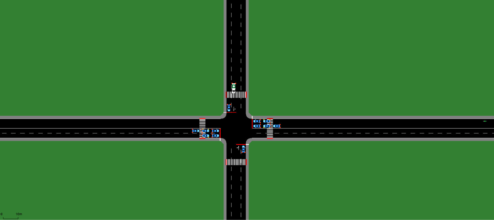
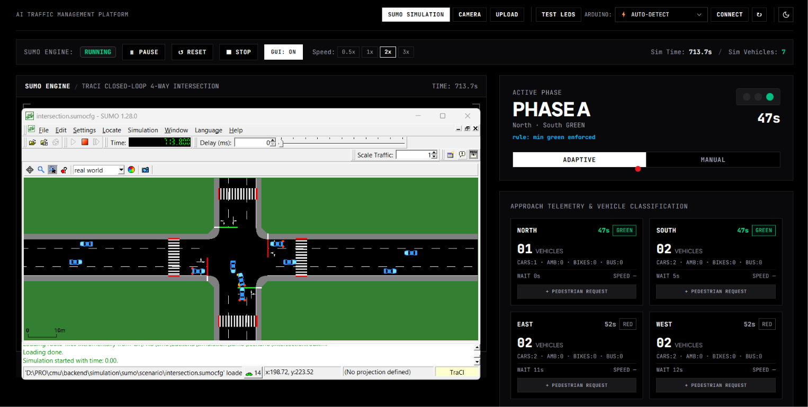
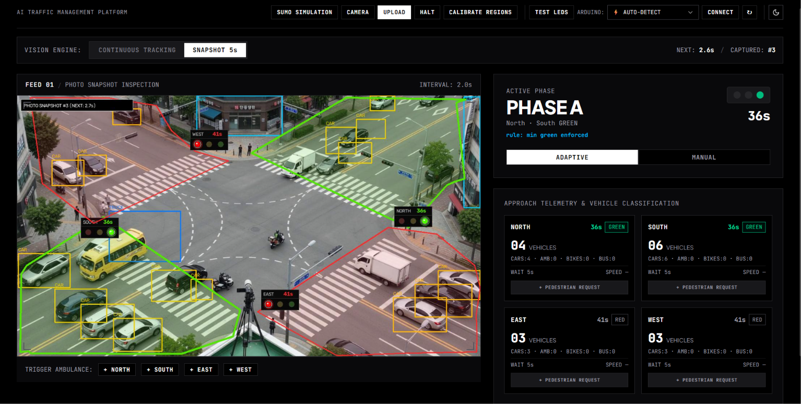
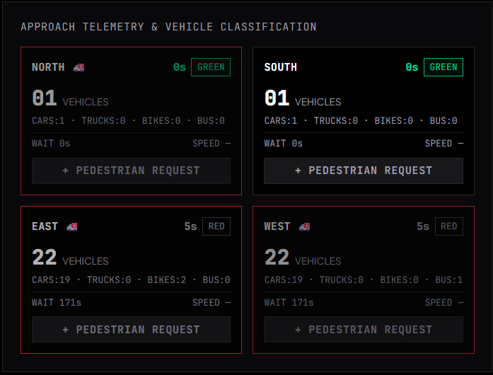
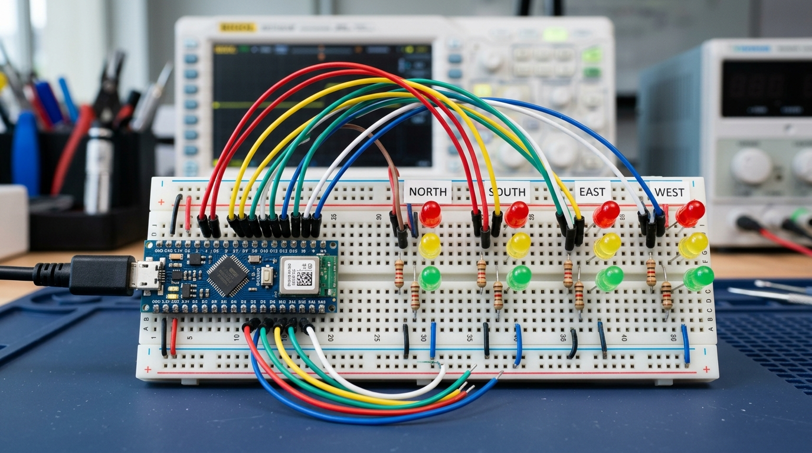
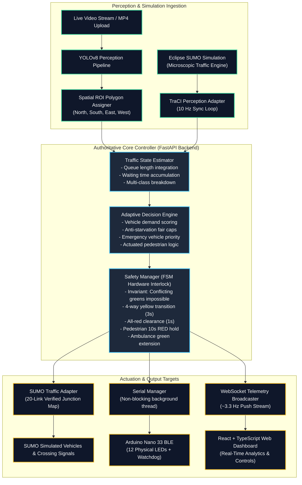

# AI Traffic Management Platform

<div align="center">

[](https://fastapi.tiangolo.com)
[](https://react.dev)
[](https://www.typescriptlang.org)
[](https://tailwindcss.com)
[](https://eclipse.dev/sumo/)
[](https://github.com/ultralytics/ultralytics)
[](https://www.arduino.cc)
[](LICENSE)

**An intelligent, multi-modal adaptive traffic signal control system combining real-time computer vision, closed-loop microscopic simulation, emergency vehicle preemption, and physical hardware actuation.**

*Developed as part of the **Carnegie Mellon University - Bridge Program** by **Group 5**.*

</div>

---

## 📸 Visual Showcase

### 1. Eclipse SUMO Microscopic Simulation Network
High-fidelity 4-way intersection topology modeled in Eclipse SUMO with multi-lane approaches, dedicated turn bays, pedestrian crossings, and vehicle routing.

<div align="center">
  
</div>

---

### 2. Live Dashboard in SUMO Simulation Mode
Real-time TraCI closed-loop synchronization at 10 Hz with approach queue telemetry, waiting times, dynamic phase scheduling, and interactive docking viewport.

<div align="center">
  
</div>

---

### 3. Live Dashboard with Video Upload & YOLOv8 Perception
Overhead camera footage processed with YOLOv8 object detection, multi-class vehicle classification, approach polygon ROI spatial zoning, and anti-starvation wait-time metrics.

<div align="center">
  
</div>

---

### 4. Multi-Approach Telemetry & Emergency Vehicle Preemption
Approach telemetry showing live vehicle counters, classification breakdown (Cars, Buses, Trucks, Motorcycles, Bicycles, Ambulances), signal states, and pedestrian demand triggers.

<div align="center">
  
</div>

---

### 5. Physical Arduino Hardware Breadboard Actuation
Physical breadboard setup with 12 external LEDs (Red, Yellow, Green for North, South, East, West) synchronized in real-time with the AI controller.

<div align="center">
  
</div>

---

## 🚀 Key Features

- **Multi-Modal Perception Engine:**
  - **YOLOv8 Vision**: Real-time object detection and classification for cars, trucks, buses, motorcycles, bicycles, and emergency vehicles.
  - **Overhead Video & Camera Streams**: Supports live webcams, recorded footage upload (`.mp4`), and snapshot-sampling modes.
  - **Polygon ROI Spatial Tracking**: Calibrated bounding zones per approach (North, South, East, West) with sub-second occupancy and queue estimation.

- **Closed-Loop Microscopic Simulation (Eclipse SUMO):**
  - **TraCI Integration**: Bidirectional synchronous simulation step loop (10 Hz).
  - **Dynamic Emergency Preemption**: Auto-detects ambulances, overrides standard cycle to clear conflicting traffic, and automatically resumes normal flow once cleared.
  - **Pedestrian Safety Phase**: 10-second synchronized pedestrian crosswalk lock with all-red vehicular clearance.
  - **Instant Reset**: Hot in-process simulation reset via `traci.load` without restarting the engine.

- **Adaptive Traffic Optimization & Safety Manager:**
  - **Dual-Phase Actuation**: Phase A (North & South) and Phase B (East & West).
  - **Anti-Starvation Fair Caps**: Upper-bound wait time limits prevent lower-volume approaches from experiencing starvation.
  - **Dynamic Green Extension**: Adjusts green time based on real-time vehicle density and queue pressure.

- **Cross-Platform Physical Hardware Actuation:**
  - **Arduino Nano 33 BLE / Uno / Nano**: Controls 12 physical LEDs representing 4 intersection approaches.
  - **Zero-Config Auto-Detect**: Dynamically queries the host OS (`serial.tools.list_ports`) on Windows (`COM*`), Linux (`/dev/tty*`), and macOS (`/dev/cu.*`).
  - **Watchdog Failsafe**: Microcontroller automatically triggers yellow-blinking fail-safe if the software host loses connection for >6 seconds.

- **Modern Minimalist UI (React + TypeScript):**
  - **High-Contrast Design**: High-contrast Dark and Light themes with animated Radix UI toggles.
  - **Accessible shadcn/ui Primitives**: Accessible dropdowns for serial ports, environment toggles, and modal controls.
  - **Real-Time Telemetry**: Sub-second WebSocket telemetry pushes data at ~3.3 Hz.

---

## 🏗️ System Architecture



> 📖 **Deep Dive:** For detailed sequence diagrams, mathematical models, and FSM transition rules, see [docs/ARCHITECTURE.md](docs/ARCHITECTURE.md) and [docs/WORKING_PRINCIPLE.md](docs/WORKING_PRINCIPLE.md).

---

## 📁 Repository Structure & Documentation

```
ai-traffic-platform/
├── backend/
│   ├── api/                    # REST routes (video, simulation, controller, serial)
│   ├── config/                 # Pydantic system settings & .env support
│   ├── controller/             # Safety manager, signal FSM, and serial worker
│   ├── core/                   # Shared application state singleton & models
│   ├── services/               # Vision, decision loop, telemetry broadcaster
│   ├── simulation/sumo/        # Eclipse SUMO scenario, TraCI manager, 20-link adapter
│   ├── tests/                  # Automated unit & regression test suite
│   ├── traffic/                # Estimation, queue calculation, timing engine
│   ├── vision/                 # YOLOv8 inference, ROI spatial tracker, camera pipeline
│   ├── main.py                 # FastAPI application entry point
│   └── requirements.txt        # Python backend dependencies
├── frontend/
│   ├── src/
│   │   ├── api/                # Axios API client wrapper
│   │   ├── components/         # Modular React UI components (Header, Grid, Monitor)
│   │   ├── components/ui/      # Accessible shadcn/ui primitives
│   │   ├── context/            # ThemeContext (Dark / Light mode provider)
│   │   ├── hooks/              # WebSocket telemetry subscription hook
│   │   ├── types/              # Comprehensive TypeScript interfaces
│   │   ├── App.tsx             # Main dashboard view
│   │   └── index.css           # Tailwind CSS styling and theme tokens
│   └── package.json            # Node.js dependencies & scripts
├── firmware/
│   └── arduino/traffic_signal/ # Arduino C++ sketch for 12-LED hardware controller
├── docs/
│   ├── GETTING_STARTED.md      # Installation, uv package manager, and testing guide
│   ├── ARCHITECTURE.md         # Detailed system architecture & Mermaid diagrams
│   ├── WORKING_PRINCIPLE.md    # Scientific principles, FSM invariants & timing logic
│   ├── USER_GUIDE.md           # Dashboard operator walkthrough & feature guide
│   ├── HARDWARE.md             # Pin mapping, wiring diagrams, and serial protocol
│   └── images/                 # Architecture, simulation, and UI screenshots
├── CONTRIBUTING.md              # Open source contribution guidelines
├── LICENSE                      # MIT Open Source License
└── README.md                   # Project documentation
```

---

## ⚡ Quick Start Guide

### 1. Prerequisites
- **Python 3.10+** (or **uv** for ultra-fast setup)
- **Node.js 18+** & **npm**
- **Eclipse SUMO 1.20+** (ensure `SUMO_HOME` environment variable is set)
- *(Optional)* **Arduino IDE** (for physical 12-LED breadboard actuation)

---

### 2. Backend Setup

#### Option A: Using `uv` (Fast & Recommended)
```bash
# Clone the repository
git clone https://github.com/bendeze/ai-traffic-platform.git
cd ai-traffic-platform/backend

# Create virtual environment & install dependencies
uv venv
# Windows: .venv\Scripts\activate  |  Linux/macOS: source .venv/bin/activate
uv pip install -r requirements.txt

# Run automated test suite
# Windows (PowerShell):
$env:PYTHONPATH="backend"; uv run python -m unittest discover -s tests
# Linux/macOS:
PYTHONPATH=backend uv run python -m unittest discover -s tests

# Start FastAPI server
uv run uvicorn main:app --host 0.0.0.0 --port 8000 --reload
```

#### Option B: Using Standard Python `venv` + `pip`
```bash
cd backend

# Create and activate virtual environment
python -m venv .venv
# Windows: .\.venv\Scripts\activate  |  Linux/macOS: source .venv/bin/activate

# Install dependencies
pip install -r requirements.txt

# Run automated test suite
# Windows (PowerShell):
$env:PYTHONPATH="backend"; python -m unittest discover -s tests
# Linux/macOS:
PYTHONPATH=backend python -m unittest discover -s tests

# Start FastAPI server
uvicorn main:app --host 0.0.0.0 --port 8000 --reload
```
Interactive OpenAPI documentation (Swagger) is available at `http://localhost:8000/docs`.

---

### 3. Frontend Setup
```bash
cd ../frontend

# Install dependencies
npm install

# Start Vite development server
npm run dev
```
Open `http://localhost:3000` in your browser.

---

### 4. Running the Test Suite with `uv`

The test suite covers pedestrian crossing deceleration, baseline safety intervals, SUMO TraCI translations, and vehicle dynamics:

```bash
# Run all tests
$env:PYTHONPATH="backend"; uv run python -m unittest discover -s backend/tests

# Run pedestrian crossing stop tests
uv run python -m unittest backend/tests/test_pedestrian_crossing_stop.py

# Run baseline FSM safety tests
uv run python -m unittest backend/tests/test_baseline.py
```

---

### 5. Hardware Actuation (Optional)
1. Open [`firmware/arduino/traffic_signal/traffic_signal.ino`](firmware/arduino/traffic_signal/traffic_signal.ino) in Arduino IDE.
2. Select your board (**Arduino Nano 33 BLE**, **Nano**, or **Uno**) and upload the sketch.
3. Plug the board into USB.
4. On the web dashboard, the serial dropdown will automatically detect your Arduino with `⚡ AUTO-DETECT`. Click **CONNECT** or **TEST LEDS** to trigger a hardware diagnostic sweep!
5. For full circuit schematics, see [docs/HARDWARE.md](docs/HARDWARE.md).

---

## 📚 In-Depth Documentation

Explore the comprehensive guides located in the [`docs/`](docs/) directory:

- 🚀 **[Getting Started & Testing Guide](docs/GETTING_STARTED.md):** Complete installation, `uv` configuration, environment setup, and test matrix.
- 🏛️ **[System Architecture & Design](docs/ARCHITECTURE.md):** Architectural data flow, state machine diagrams, TraCI simulation sequences, and 20-link junction maps.
- 🧠 **[Working Principles & Scientific Theory](docs/WORKING_PRINCIPLE.md):** Mathematical models, YOLOv8 spatial tracking, anti-starvation fair caps, and Kigali-standard pedestrian stops.
- 🕹️ **[Operator & User Guide](docs/USER_GUIDE.md):** Dashboard walkthrough, mode selection, simulation controls, pedestrian requests, and emergency preemption.
- 🔌 **[Hardware & Circuit Reference](docs/HARDWARE.md):** Microcontroller pin mapping, circuit schematics, serial protocol, and watchdog failsafe.

---

## API Endpoints Summary

| Method | Endpoint | Description |
| :--- | :--- | :--- |
| `GET` | `/telemetry` | Current state snapshot (signals, queues, simulation, hardware) |
| `POST` | `/controller/mode/{mode}` | Switch between `adaptive` and `manual` modes |
| `POST` | `/priority/pedestrian/{app}` | Trigger 10s pedestrian hold phase for an approach |
| `POST` | `/priority/ambulance/{app}` | Dispatch emergency vehicle preemption |
| `POST` | `/simulation/start` | Launch Eclipse SUMO microscopic simulation |
| `POST` | `/simulation/reset` | Instant in-process reset of the SUMO intersection |
| `GET` | `/serial/ports` | Query OS for connected USB/Serial microcontrollers |
| `POST` | `/serial/connect` | Connect to specified port or auto-detect Arduino |
| `POST` | `/serial/test` | Trigger 12-LED diagnostic hardware test sweep |
| `WS` | `/ws/telemetry` | Real-time bi-directional telemetry broadcast socket |

---

## Contributing

Contributions, feedback, and pull requests are warmly welcomed! Please read [CONTRIBUTING.md](CONTRIBUTING.md) for details on code style, branch naming, and pull request procedures.

---

## License & Attribution

This project is open-source software licensed under the **[MIT License](LICENSE)**.

Developed by **Group 5** for the **Carnegie Mellon University - Bridge Program**.
Copyright &copy; 2026 Group 5 · CMU - Bridge Program Project.
