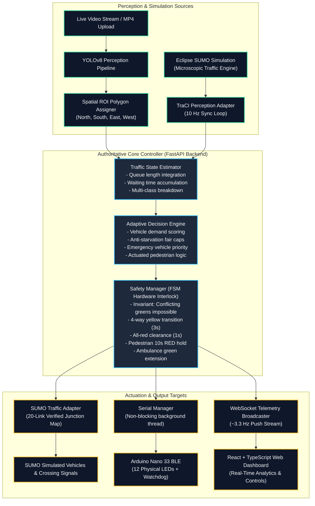
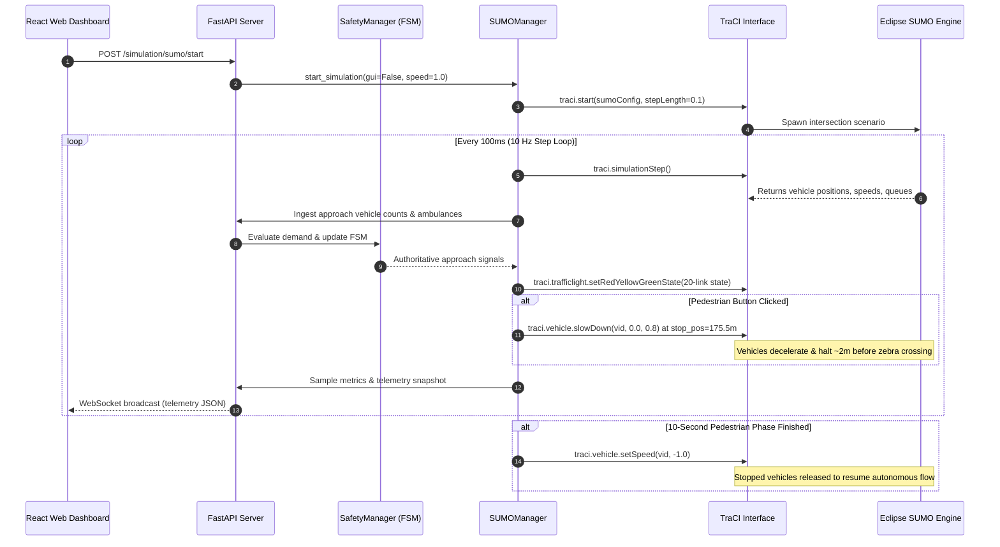
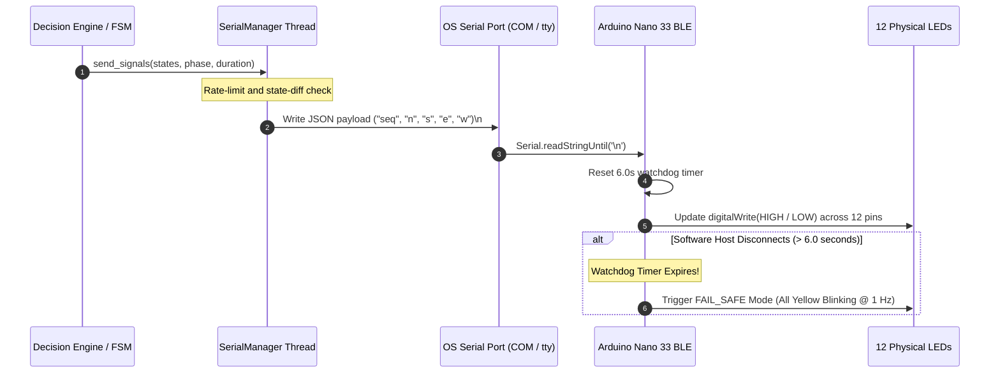
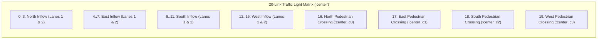

# System Architecture & Technical Design

The **AI Traffic Management Platform** is engineered as a robust, low-latency, modular distributed system designed for intersection control. It combines edge computer vision, microscopic simulation feedback, state-machine safety interlocks, and physical microcontroller actuation.

---

## High-Level System Architecture



---

## 🛡️ Finite State Machine (FSM) Safety Interlock

The traffic signal lifecycle is strictly governed by [`SafetyManager`](../backend/controller/safety_manager.py). No transition between conflicting phases is ever permitted without traversing the mandatory clearance sequence.

```mermaid
stateDiagram-v2
    [*] --> Phase_A_Green: Initialization

    state Phase_A_Green {
        North_South: GREEN (Moving)
        East_West: RED (Waiting)
        Crossings: RED (Don't Walk)
    }

    state Phase_B_Green {
        East_West: GREEN (Moving)
        North_South: RED (Waiting)
        Crossings: RED (Don't Walk)
    }

    state Yellow_Transition {
        Standard: All 4 approaches YELLOW (3s)
        Pedestrian_Req: Active phase YELLOW (3s)
    }

    state All_Red_Clearance {
        All_Approaches: RED (1s)
        Intersection_Cleared: Vehicles vacate junction box
    }

    state Pedestrian_Lock {
        Requested_Road: LOCKED ON RED (10s)
        Conflicting_Phase: GREEN (or Clearance)
        Crosswalk: GREEN (Walk signal active)
        Vehicles: Halt ~2m before zebra crossing (175.5m)
    }

    state Emergency_Preemption {
        Ambulance_Approach: IMMEDIATE GREEN
        Other_Approaches: RED
        Crossings: RED
        Hold_Active: Stays green until ambulance clears road
    }

    Phase_A_Green --> Yellow_Transition: Timer expired or dynamic transition
    Yellow_Transition --> All_Red_Clearance: Yellow elapsed (3s)
    All_Red_Clearance --> Phase_B_Green: Clearance elapsed (1s)

    Phase_B_Green --> Yellow_Transition: Timer expired or dynamic transition
    Yellow_Transition --> All_Red_Clearance: Yellow elapsed (3s)
    All_Red_Clearance --> Phase_A_Green: Clearance elapsed (1s)

    Phase_A_Green --> Pedestrian_Lock: Pedestrian button clicked on North or South
    Phase_B_Green --> Pedestrian_Lock: Pedestrian button clicked on East or West
    Pedestrian_Lock --> Yellow_Transition: 10s timer expires (Auto-resumes traffic)

    Phase_A_Green --> Emergency_Preemption: Ambulance detected on East or West
    Phase_B_Green --> Emergency_Preemption: Ambulance detected on North or South
    Emergency_Preemption --> All_Red_Clearance: Ambulance clears junction
```

---

## 🔄 Closed-Loop SUMO Microscopic Simulation Sequence

In Simulation Mode, the backend interacts synchronously with Eclipse SUMO via the TraCI socket protocol:



---

## ⚡ Hardware Microcontroller Serial Communication Loop

The backend communicates with the physical Arduino controller over an asynchronous non-blocking serial channel:



---

## 🚦 Verified 20-Link SUMO Junction Mapping

The intersection junction is mapped into 20 link indices for comprehensive vehicular and pedestrian control:



