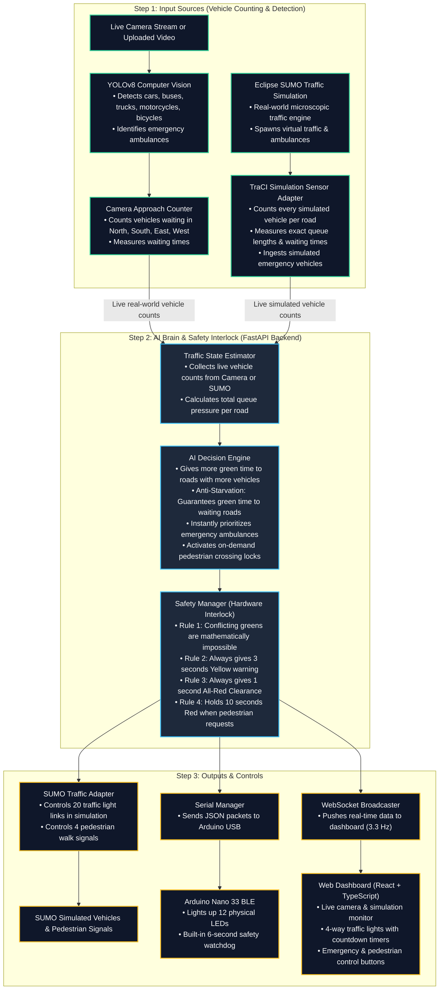
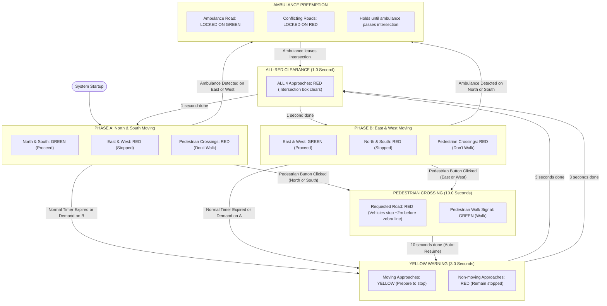
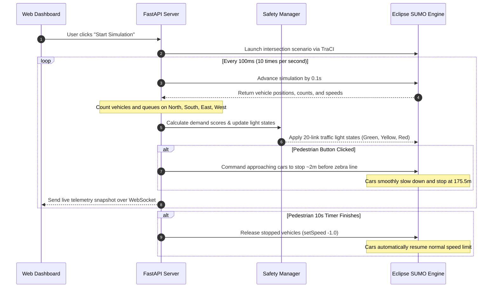
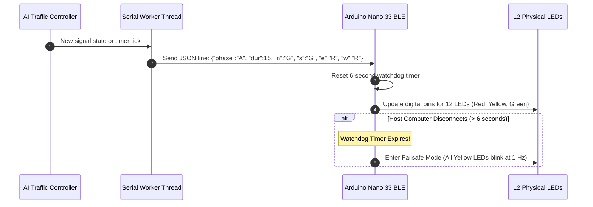
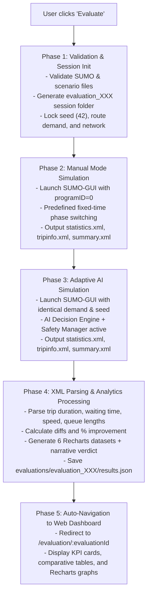

# System Architecture & Technical Design

The **AI Traffic Management Platform** is designed to be simple, reliable, and modular. It manages a 4-way intersection by combining real-time camera vision, traffic simulation, an authoritative safety controller, and physical LED hardware.

---

## 1. High-Level System Architecture

Both the camera and the simulation count vehicles in real time. These vehicle counts are sent to the AI Decision Engine to calculate the smartest green light timings.

---

## 2. Finite State Machine (FSM) Safety Interlock

The traffic light state machine is strictly controlled by [`SafetyManager`](../backend/controller/safety_manager.py). Green lights for conflicting roads can never happen at the same time. The signals always move through a mandatory yellow and all-red clearance interval before switching.

---

## 3. How Simulation Works (TraCI Closed-Loop Sequence)

In simulation mode, the system communicates with Eclipse SUMO every 100 milliseconds (10 times per second):

---

## 4. Hardware Communication & Failsafe Watchdog

The backend communicates with the physical Arduino controller over a USB serial connection at 9600 baud:

---

## 5. 20-Link Traffic Light Mapping for the 4-Way Intersection

The intersection traffic light controller (`center`) coordinates 20 distinct links:

- **Links 0 to 3:** North incoming vehicles (Left turn, Straight lanes, Right turn)
- **Links 4 to 7:** East incoming vehicles (Left turn, Straight lanes, Right turn)
- **Links 8 to 11:** South incoming vehicles (Left turn, Straight lanes, Right turn)
- **Links 12 to 15:** West incoming vehicles (Left turn, Straight lanes, Right turn)
- **Link 16:** North pedestrian zebra crossing (`:center_c0`)
- **Link 17:** East pedestrian zebra crossing (`:center_c1`)
- **Link 18:** South pedestrian zebra crossing (`:center_c2`)
- **Link 19:** West pedestrian zebra crossing (`:center_c3`)

---

## 6. Automated Simulation Evaluation Architecture (A/B Benchmark)

The evaluation system uses an automated dual-phase pipeline to generate quantifiable, non-destructive performance comparisons:

### Key Analytical Guarantees:
1. **Deterministic Traffic Demand:** Both simulations use identical random seeds (`42`), vehicle routes (`intersection.rou.xml`), and network topology (`intersection.net.xml`), ensuring fair and mathematically sound comparison.
2. **Scientific Metric Tracking:** Never substitutes zeroes for missing metrics without explicit flags; extracts raw completed trip files directly from SUMO engine outputs.
3. **Non-Destructive Persistence:** Historical runs are archived sequentially (`evaluation_001`, `evaluation_002`, ...) without overwriting past data.
