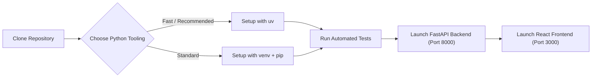

# Getting Started Guide

Welcome to the **AI Traffic Management Platform**. This guide provides step-by-step instructions for installing dependencies, configuring your environment, running the system with modern tooling (including `uv` and standard Python tooling), executing the test suite, and connecting hardware.

---

## 📋 System Prerequisites

| Component | Minimum Version | Notes |
| :--- | :--- | :--- |
| **Python** | `3.10` or higher | Recommended: Python `3.11` – `3.14` |
| **uv** | `0.1.0` or higher | Modern, high-performance Python package installer & runner |
| **Node.js** | `18.0.0` or higher | Required for the React/TypeScript frontend |
| **npm** | `9.0.0` or higher | Included with Node.js |
| **Eclipse SUMO** | `1.20.0` or higher | Required for microscopic closed-loop simulation |
| **Arduino IDE** | `2.0+` *(Optional)* | Required only for physical 12-LED breadboard actuation |

---

## 🛠️ Step 1: Clone the Repository

```bash
git clone https://github.com/bendeze/ai-traffic-platform.git
cd ai-traffic-platform
```

---

## 🐍 Step 2: Backend Setup & Testing

You can set up the backend using either **`uv`** (ultra-fast, recommended) or standard **Python `venv` + `pip`**.



### Option A: Using `uv` (Fast & Recommended)

[`uv`](https://github.com/astral-sh/uv) provides instant virtual environment creation and package installation:

```bash
cd backend

# 1. Create a virtual environment using uv
uv venv

# 2. Activate the virtual environment
# On Windows:
.venv\Scripts\activate
# On Linux/macOS:
source .venv/bin/activate

# 3. Install all dependencies from requirements.txt
uv pip install -r requirements.txt
```

#### Running Tests with `uv`

You can execute the automated test suite directly using `uv run`:

```bash
# Set PYTHONPATH so tests resolve the backend package
# On Windows (PowerShell):
$env:PYTHONPATH="backend"
uv run python -m unittest discover -s tests

# On Linux/macOS:
PYTHONPATH=backend uv run python -m unittest discover -s tests

# Or run specific test suites with uv:
uv run python -m unittest tests/test_pedestrian_crossing_stop.py
uv run python -m unittest tests/test_baseline.py
uv run python -m unittest tests/test_sumo_traffic_adapter.py
```

#### Starting the Backend Server with `uv`

```bash
uv run uvicorn main:app --host 0.0.0.0 --port 8000 --reload
```

---

### Option B: Using Standard Python `venv` + `pip`

```bash
cd backend

# 1. Create virtual environment
python -m venv .venv

# 2. Activate the environment
# On Windows:
.\.venv\Scripts\activate
# On Linux/macOS:
source .venv/bin/activate

# 3. Upgrade pip and install dependencies
pip install --upgrade pip
pip install -r requirements.txt

# 4. Run tests
# On Windows (PowerShell):
$env:PYTHONPATH="backend"
python -m unittest discover -s tests

# On Linux/macOS:
PYTHONPATH=backend python -m unittest discover -s tests

# 5. Start development server
uvicorn main:app --host 0.0.0.0 --port 8000 --reload
```

Interactive OpenAPI documentation (Swagger) is immediately available at `http://localhost:8000/docs`.

---

## 🎨 Step 3: Frontend Setup

In a new terminal window:

```bash
cd frontend

# Install Node dependencies
npm install

# Start Vite development server
npm run dev
```

Open your browser at `http://localhost:3000` (or `http://localhost:3001` if port 3000 is occupied).

---

## 🚗 Step 4: Eclipse SUMO Microscopic Simulation Setup

To run closed-loop microscopic traffic simulations:

1. **Install Eclipse SUMO**:
   - **Windows**: Download the official installer from [eclipse.dev/sumo](https://eclipse.dev/sumo/) (or `winget install Eclipse.SUMO`).
   - **Ubuntu/Debian**: `sudo apt install sumo sumo-tools sumo-doc`.
   - **macOS**: `brew install sumo`.

2. **Verify Environment Variables**:
   Ensure `SUMO_HOME` points to your SUMO installation directory:
   - Windows: `C:\Program Files (x86)\Eclipse\SUMO`
   - Linux/macOS: `/usr/share/sumo` or `/opt/homebrew/opt/sumo/share/sumo`
   
   Test your setup by running:
   ```bash
   sumo --version
   ```

3. **In the Web Dashboard**:
   - Click the **SUMO SIMULATION** mode button in the header.
   - Click **▶ Start Simulation** to spawn traffic in SUMO and stream real-time queue states directly into the AI Decision Engine!

---

## 🔌 Step 5: Connecting Physical Hardware (Optional)

1. Open [`firmware/arduino/traffic_signal/traffic_signal.ino`](../firmware/arduino/traffic_signal/traffic_signal.ino) in the Arduino IDE.
2. Select your board (**Arduino Nano 33 BLE**, **Nano**, or **Uno**) and click **Upload**.
3. Plug the Arduino into your computer via USB.
4. On the web dashboard, the serial port dropdown will automatically scan and detect the device with `⚡ AUTO-DETECT`.
5. Click **CONNECT** or click **TEST LEDS** to execute a 12-LED verification sweep across North, South, East, and West.
6. For pinout schematics and resistor values, refer to [`docs/HARDWARE.md`](HARDWARE.md).

---

## 🧪 Comprehensive Test Suite Matrix

The repository includes comprehensive unit and integration tests under `backend/tests/`:

| Test Suite | File | Focus Areas |
| :--- | :--- | :--- |
| **Pedestrian Crossing Stop** | `test_pedestrian_crossing_stop.py` | Multi-tier deceleration, ~2m zebra line clearance, ambulance priority, auto-resumption. |
| **Baseline Timing & Safety** | `test_baseline.py` | FSM clearance, 3s yellow interval, 1s all-red clearance, anti-starvation. |
| **SUMO 20-Link Adapter** | `test_sumo_traffic_adapter.py` | TraCI 20-link traffic light mapping (16 vehicular + 4 crosswalk links). |
| **Core State Container** | `test_core_state.py` | AppState single-container integrity and telemetry serialization. |
| **API Endpoints** | `test_api_routes.py` | REST routes, priority preemption, mode toggles, status codes. |
| **Vehicle Dynamics** | `test_sumo_vehicle_dynamics.py` | TraCI speed controllers, acceleration limits, collision avoidance. |
| **Perception Adapter** | `test_sumo_perception.py` | Sensor emulation, detection bounding boxes, approach counting. |

Run all tests anytime with:
```bash
$env:PYTHONPATH="backend"; uv run python -m unittest discover -s backend/tests
```

