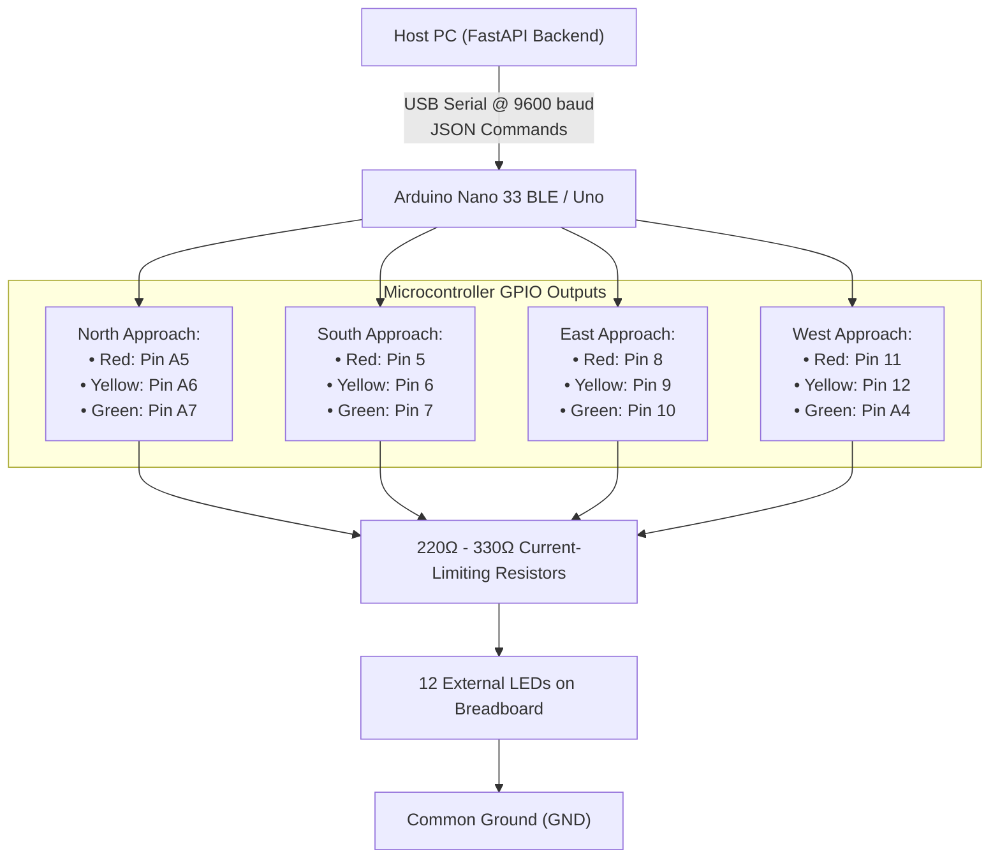
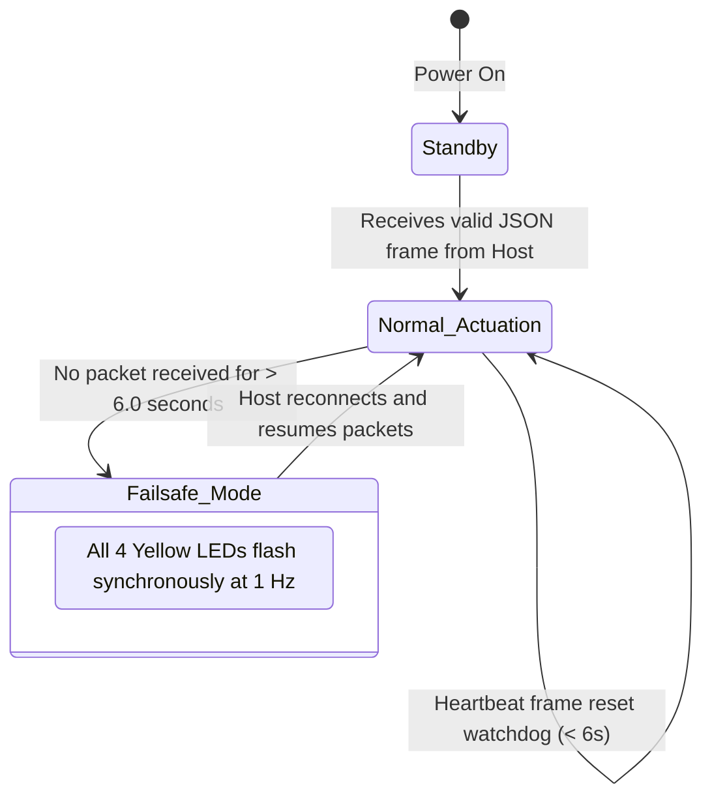

# Hardware Integration & Circuit Reference

The **AI Traffic Management Platform** features direct physical actuation through an **Arduino Nano 33 BLE** (or standard Arduino Nano / Uno). The controller drives 12 external LEDs across a 4-way intersection (3 LEDs per approach: Red, Yellow, Green) using non-blocking serial communication and hardware failsafe watchdogs.

---

## Circuit Interconnect Architecture



---

## Pinout & Wiring Specifications

| Approach | Signal Color | Microcontroller Pin | Resistor | Function |
| :--- | :--- | :--- | :--- | :--- |
| **North** | **RED** | `Pin A5` | 220Ω – 330Ω | North stop indication |
| **North** | **YELLOW** | `Pin A6` | 220Ω – 330Ω | North transition warning |
| **North** | **GREEN** | `Pin A7` | 220Ω – 330Ω | North proceed indication |
| **South** | **RED** | `Pin 5` | 220Ω – 330Ω | South stop indication |
| **South** | **YELLOW** | `Pin 6` | 220Ω – 330Ω | South transition warning |
| **South** | **GREEN** | `Pin 7` | 220Ω – 330Ω | South proceed indication |
| **East** | **RED** | `Pin 8` | 220Ω – 330Ω | East stop indication |
| **East** | **YELLOW** | `Pin 9` | 220Ω – 330Ω | East transition warning |
| **East** | **GREEN** | `Pin 10` | 220Ω – 330Ω | East proceed indication |
| **West** | **RED** | `Pin 11` | 220Ω – 330Ω | West stop indication |
| **West** | **YELLOW** | `Pin 12` | 220Ω – 330Ω | West transition warning |
| **West** | **GREEN** | `Pin A4` | 220Ω – 330Ω | West proceed indication |

> **Wiring Note:** Anode (+) connects to the specified pin. Cathode (-) connects through a 220Ω–330Ω current-limiting resistor to common `GND`.

---

## Serial Communication Protocol

Baud rate: **`9600 baud`**, 8-N-1. Data is sent as single-line JSON terminating with `\n`.

### 1. Frame-Accurate Direct State Sync
Dispatched every time a phase changes or a countdown state updates:
```json
{"seq": 142, "phase": "A", "dur": 15, "n": "G", "s": "G", "e": "R", "w": "R"}
```
- `n`, `s`, `e`, `w`: `'G'` (Green), `'Y'` (Yellow), `'R'` (Red).
- Non-blocking: dispatched via dedicated background Python worker thread.

### 2. Hardware Self-Test Diagnostic Sweep
Initiates sequential 12-LED diagnostic hardware test across all approaches:
```json
{"cmd": "test"}
```

### 3. Failsafe Watchdog
If the Arduino loses connection with the backend for more than **6.0 seconds**, it automatically transitions into **`FAIL_SAFE`** mode (flashing all yellow signals at 1 Hz) to prevent intersection gridlock.



