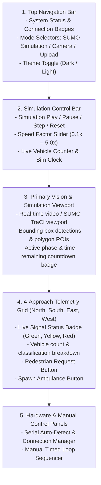
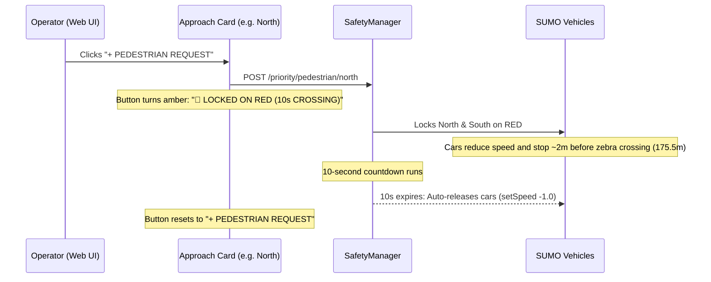

# User & Operator Guide

This guide walks you through using the **AI Traffic Management Platform** web dashboard, operating the microscopic simulation, controlling physical hardware, and triggering priority overrides.

---

## 🖥️ Dashboard Overview

The dashboard interface is organized into five functional regions:

---

## 🎮 1. Operating Modes

In the top navigation header, select between three primary operational sources:

### A. SUMO Simulation Mode (Default)
- **Purpose:** Full closed-loop microscopic traffic simulation with multi-lane vehicle flow, queue formation, and signal response.
- **How to Use:**
  1. Click the **SUMO SIMULATION** button in the header.
  2. Click **▶ Start** in the simulation control bar.
  3. Traffic will begin flowing autonomously through the 4-way intersection.

### B. Live Camera Mode
- **Purpose:** Processes video directly from a connected USB webcam or IP camera stream.
- **How to Use:**
  1. Click **CAMERA** in the header.
  2. Select your camera device index.
  3. The YOLOv8 perception pipeline will begin detecting vehicles in real-time.

### C. Video Upload Mode
- **Purpose:** Analyze pre-recorded intersection footage (`.mp4`, `.avi`, `.mov`).
- **How to Use:**
  1. Click **UPLOAD** in the header.
  2. Drag and drop your video file into the upload zone.
  3. The system processes the footage frame-by-frame, estimating queues and controlling signals accordingly.

---

## 🕹️ 2. Simulation Controls

When in **SUMO Simulation** mode, use the simulation toolbar to manipulate the environment:

| Control | Action | Notes |
| :--- | :--- | :--- |
| **▶ Start / Resume** | Starts or unpauses stepping | Advances simulation at selected speed factor |
| **⏸ Pause** | Freezes simulation state | Holds vehicle positions and signal timers |
| **⏭ Step** | Advances simulation by 1 step (100ms) | Ideal for precise frame-by-frame verification |
| **🔄 Reset** | Instant reload to $t=0.0\text{s}$ | Uses in-process `traci.load` without restarting server |
| **Speed Slider** | Controls simulation rate ($0.1\times$ to $5.0\times$) | Accelerate simulation for long-run benchmarks |

---

## 🚶 3. Triggering Pedestrian Crosswalk Requests

Each approach card in the **Approach Telemetry Grid** contains an interactive **`+ PEDESTRIAN REQUEST`** button:

1. Click **`+ PEDESTRIAN REQUEST`** on any approach (e.g., **North**).
2. The button transforms into an active indicator: **`🚶 LOCKED ON RED (10s CROSSING)`**.
3. Approaching vehicles decelerate smoothly and come to a complete stop $\sim 2\text{m}$ in advance of the zebra crossing line.
4. When the 10-second crosswalk timer expires, vehicles automatically resume normal speed and proceed through the junction.
5. If no button is clicked, regular cycling continues without any added delay.

---

## 🚑 4. Simulating Emergency Ambulance Preemption

To test immediate green preemption:

1. Locate the **`🚑 SPAWN AMBULANCE`** button on any approach card.
2. Click the button to inject an emergency ambulance vehicle into the incoming lane in SUMO.
3. The dashboard displays the emergency banner: **`🚨 EMERGENCY AMBULANCE PREEMPTION ACTIVE`**.
4. The system safely transitions conflicting traffic to Red and locks the ambulance's approach on **GREEN**.
5. Once the ambulance clears the intersection box, the preemption lock automatically drops and normal adaptive cycling resumes.

---

## ⏱️ 5. Manual Timed Loop Mode

If you prefer fixed-time cycling instead of adaptive AI scheduling:

1. Scroll to the **Manual Loop Panel** at the bottom of the dashboard.
2. Configure your desired green durations:
   - **Phase A (North & South):** e.g. `25 seconds`
   - **Phase B (East & West):** e.g. `20 seconds`
3. Click **Start Manual Loop**.
4. The system switches to deterministic cycling while preserving all safety clearance intervals (3s yellow and 1s all-red).
5. Click **Stop Manual Loop** to return to adaptive mode.

---

## 🔌 6. Connecting Physical Arduino Hardware

1. Connect your Arduino (Nano 33 BLE, Uno, or Nano) to your computer with a USB cable.
2. On the dashboard's **Serial Port Panel**:
   - The dropdown will show **`⚡ AUTO-DETECT`** alongside any detected system ports (`COM*` on Windows, `/dev/tty*` on Linux/macOS).
3. Click **Connect**.
4. Upon successful connection:
   - The status badge displays **`CONNECTED`** with port and baud rate.
   - Click **TEST LEDS** to trigger a diagnostic verification sweep (all 12 LEDs cycle sequentially across Red, Yellow, and Green).
5. The 12 physical LEDs will now mirror the software signals in real-time.

---

## 📊 7. Automated Simulation Evaluation & Performance Comparison

The **Simulation Evaluation** feature runs a scientific A/B benchmark comparing traditional fixed-time traffic lights against our AI-driven adaptive traffic light controller under identical traffic demand and network conditions.

### How to Run an Evaluation:
1. Ensure the simulation environment is selected (`SUMO SIMULATION`).
2. Beside the **▶ START** button, click **📊 EVALUATE**.
3. The evaluation orchestrator automatically executes two phases:
   - **Phase 1 (Manual Mode):** Runs SUMO with traditional predefined fixed-time signals, collecting baseline waiting time, queue progression, and throughput.
   - **Phase 2 (Adaptive Mode):** Re-runs SUMO using the exact same random seed (`42`), vehicle routes, and arrival demand, but controlled by our AI Decision Engine, Safety Manager, and TraCI adapters.
4. During evaluation, the live progress badge indicates which mode is running (e.g., `Manual Mode running (35%)` ➔ `Adaptive Mode running (75%)`). SUMO-GUI opens on your desktop so you can observe the simulation visually in real-time.
5. Upon completion, the system automatically redirects to `/evaluation/:evaluationId`.

### What You See on the Evaluation Dashboard:
- **Executive Verdict Banner:** Clear statistical conclusion on which system performed better.
- **KPI Comparison Cards:** Summary comparison of Average Waiting Time, Average Travel Time, Vehicle Speed, Maximum Queue Length, Vehicles Arrived, and Total Time Loss with percentage improvement indicators.
- **Detailed Comparison Table:** Metric-by-metric breakdown highlighting winning mode and differences.
- **Interactive Recharts Visualizations:**
  1. *Average Waiting Time Comparison* (Bar chart)
  2. *Average Travel Time Comparison* (Bar chart)
  3. *Vehicle Speed Comparison* (Bar chart)
  4. *Queue Length Over Time* (Line chart comparing halted queue progression)
  5. *Waiting Time Distribution* (Histogram categorized into delay brackets: `0-10s`, `10-20s`, `20-30s`, `30-40s`, `40s+`)
  6. *Vehicle Throughput* (Cumulative vehicle arrival curves over time)
- **Objective Narrative Analysis:** Comprehensive breakdown explaining how dynamic phase allocation relieves congestion pressure while honoring safety constraints.
- **Session History & JSON Export:** Dropdown to review past evaluations and button to export full JSON reports.

