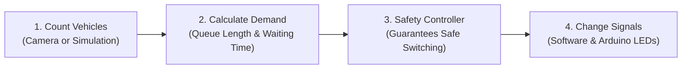
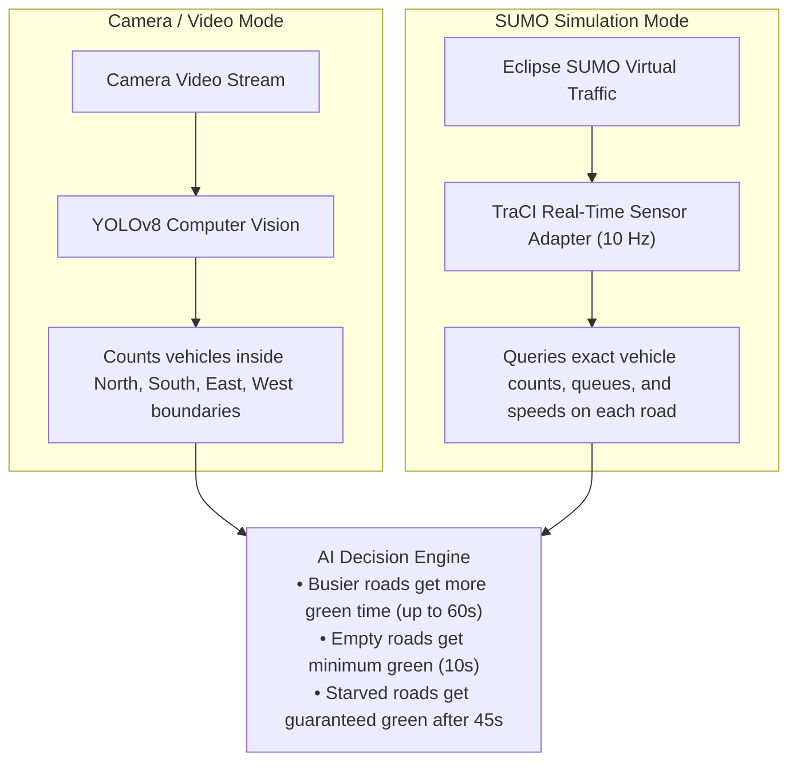
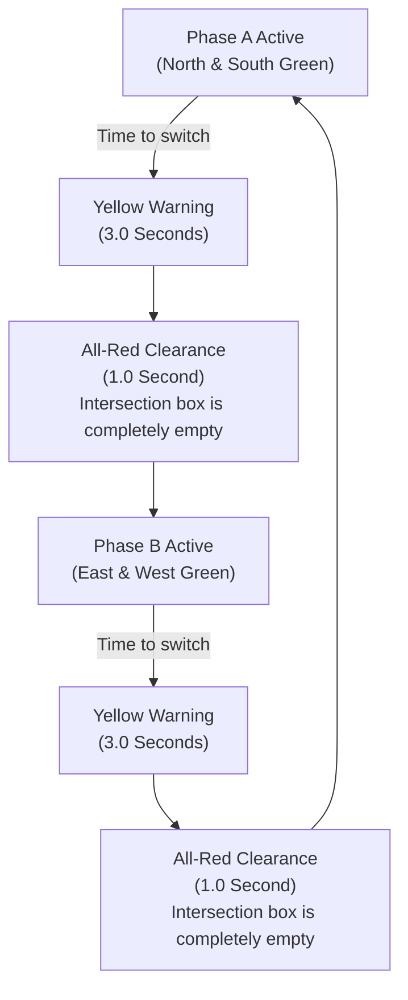
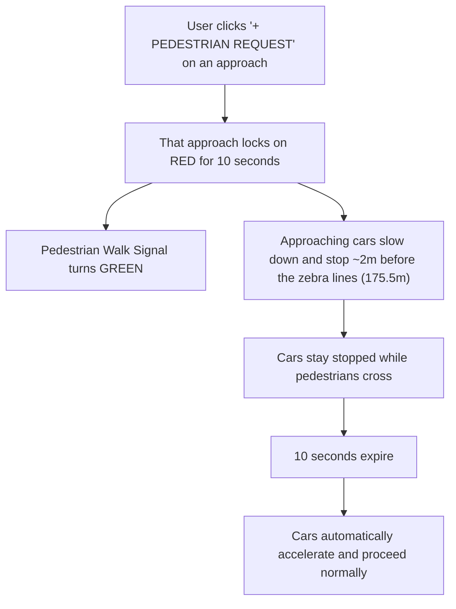

# How It Works: Working Principles & Design

This guide explains how the **AI Traffic Management Platform** operates in simple, easy-to-understand terms.

---

## 🚦 The Main Problem We Solve

Traditional traffic lights operate on fixed timers (for example, always giving 30 seconds green to North/South and 30 seconds green to East/West). This causes major problems:
- **Wasted Green Time:** Lights stay green for empty roads while cars sit waiting on busy roads.
- **Traffic Starvation:** Side roads with fewer cars can be trapped waiting for a long time.
- **Pedestrian Safety Risks:** Pedestrians have to cross without safe, dedicated stopping intervals.
- **Emergency Delays:** Ambulances get stuck behind red lights and stopped traffic.

Our system replaces rigid fixed timers with an intelligent, demand-responsive control system:

---

## 🚗 How Vehicle Counting Works: Camera vs. Simulation

A common question is: *Do we count vehicles in simulation just like we do on camera video?*

**Yes! In both modes, the system counts every single vehicle to decide green light timings.**

- **In Camera / Video Mode:**
  The YOLOv8 deep learning model spots vehicles (cars, trucks, buses, motorcycles, bicycles, and ambulances) in the video frames. A spatial area detector checks which road (North, South, East, or West) each vehicle is waiting on and counts them.

- **In SUMO Simulation Mode:**
  The `TraCI Perception Adapter` queries the simulation engine 10 times every second (`10 Hz`). It counts every simulated car currently on the incoming lanes of North, South, East, and West, measures queue lengths, records how many seconds each car has been waiting, and checks if an emergency ambulance has spawned.

Both modes send these exact numbers to the AI Decision Engine.

---

## ⚖️ How the AI Decides Green Light Times

The AI Decision Engine uses a transparent demand formula every second:

$$\text{Demand Score} = (2.5 \times \text{Total Queued Vehicles}) + (0.4 \times \text{Longest Waiting Time in Seconds})$$

### 1. Dynamic Green Extension
- If a road has heavy traffic, the green light is automatically extended up to **60 seconds** (`max_green`).
- If a road has very few cars, the green light quickly wraps up after the safe minimum of **10 seconds** (`min_green`) so waiting cars on other roads do not wait unnecessarily.

### 2. Anti-Starvation Protection (Fairness Cap)
- If cars on a red light have been waiting for **45 seconds** (`max_wait_seconds`), the system guarantees them green next, even if the other road still has traffic. This ensures fair flow and prevents traffic jams on smaller streets.

---

## 🛡️ Safety Controller (No Conflicting Greens)

Safety is strictly enforced by the [`SafetyManager`](../backend/controller/safety_manager.py) finite-state machine:

### Safety Rules That Are Never Broken:
1. **Never Double Green:** North/South and East/West green lights can never be on at the same time.
2. **Always 3 Seconds Yellow:** Moving cars always receive a 3-second yellow light warning to stop safely.
3. **Always 1 Second All-Red:** Every phase transition includes a 1-second all-red period where all 4 approaches are red so clearing cars can safely leave the junction box.
4. **Minimum 10 Seconds Green:** A green light never changes faster than 10 seconds, preventing flickering or driver confusion.

---

## 🚑 Emergency Ambulance Preemption

When an ambulance is detected on any approach:
1. **Instant Override:** The normal cyclic timer immediately pauses.
2. **Safe Transition:** Conflicting traffic gets 3 seconds yellow and 1 second all-red clearance.
3. **Green Lock:** The road with the ambulance turns **GREEN** and stays green until the ambulance drives across the intersection.
4. **Instant Return:** As soon as the ambulance clears the intersection, the hold drops and normal adaptive cycling resumes immediately.

---

## 🚶 On-Demand Pedestrian Safety (Zebra Crossings)

In Rwandan and international urban planning, zebra crossings are located $\sim 12\text{m}$ before the intersection center, and vehicles stop $\sim 2\text{m}$ before the crossing lines.

- **Strictly On-Demand:** If nobody presses the pedestrian request button, crossing signals stay Red ("Don't Walk") and vehicles drive through green lights at normal speed with **zero** added delay.

---

## 🔌 Hardware Microcontroller & Failsafe Watchdog

The platform connects to a real **Arduino Nano 33 BLE** driving 12 physical LEDs on a breadboard:
- Every time a signal changes, the backend sends a small JSON message over USB serial (`{"n":"G","s":"G","e":"R","w":"R"}`).
- **Built-in Watchdog:** If the computer ever crashes or disconnects for more than **6.0 seconds**, the Arduino automatically enters **`FAIL_SAFE`** mode (flashing all yellow lights at 1 Hz), ensuring traffic never experiences an unmanaged intersection.
