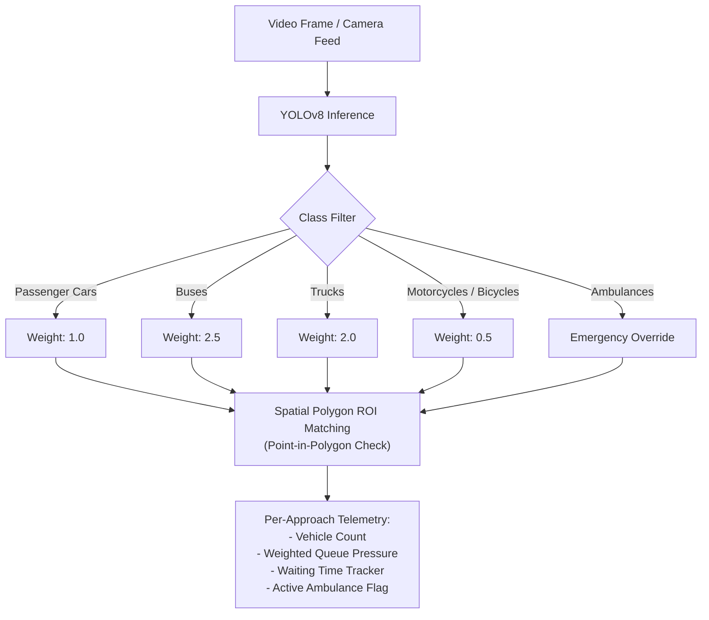
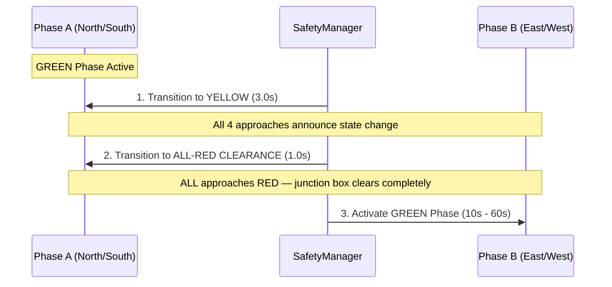
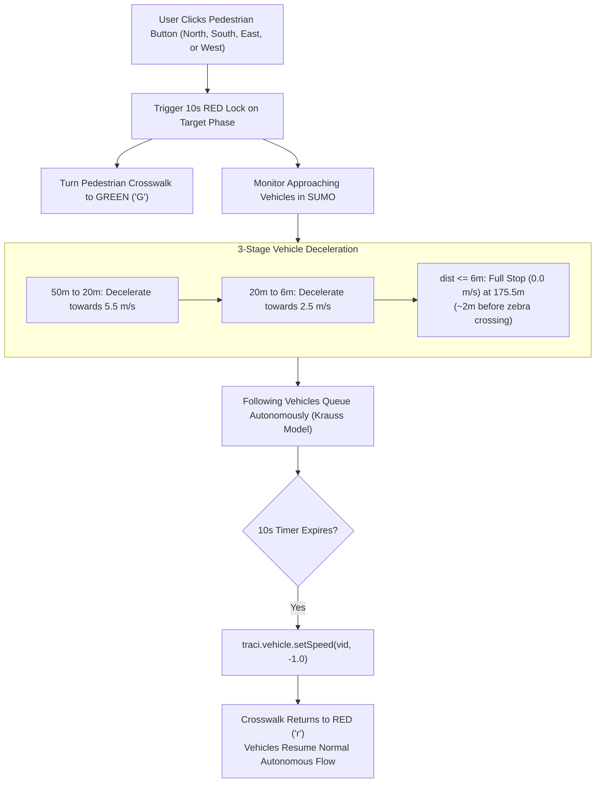

# Working Principle & Engineering Design

This document details the scientific, algorithmic, and engineering principles governing the **AI Traffic Management Platform**.

---

## 🎯 System Objectives

Traditional fixed-time and sensor-loop traffic signals suffer from significant inefficiencies:
- **Green Time Waste:** Providing green signals to empty approaches while queued traffic waits on conflicting roads.
- **Starvation & Delay:** Failing to dynamically account for queue length, vehicle types (buses vs. passenger cars), and accumulated waiting time.
- **Pedestrian Vulnerability:** Forcing pedestrians to negotiate uncoordinated vehicle flow.
- **Emergency Delays:** Delaying ambulances and first responders due to rigid phase sequencing.

The **AI Traffic Management Platform** addresses these challenges using an integrated closed-loop control system:

---

## 👁️ 1. Multi-Class Computer Vision & Spatial ROI Tracking

### Detection & Classification
- The vision pipeline leverages **Ultralytics YOLOv8** running at inference frequencies up to 30 FPS.
- Each detected bounding box is assigned a bottom-center anchor point $(x_c, y_{max})$ representing the vehicle's road contact patch.
- Polygon regions-of-interest (ROIs) define the approach boundaries:
  - `North Approach Polygon`
  - `South Approach Polygon`
  - `East Approach Polygon`
  - `West Approach Polygon`
- A point-in-polygon algorithm maps each vehicle to its designated approach.

---

## ⚖️ 2. Dynamic Demand Scoring & Anti-Starvation Logic

To optimize throughput without starving low-volume roads, the [`DecisionEngine`](../backend/traffic/decision_engine.py) computes dynamic phase scores every step:

$$\text{Score}(\text{Phase}) = 2.5 \times Q_{\text{phase}} + 0.4 \times W_{\text{max}}$$

Where:
- $Q_{\text{phase}}$ is the sum of queue estimates across all approaches in that phase.
- $W_{\text{max}}$ is the maximum waiting time (in seconds) experienced by any vehicle in that phase.

### Anti-Starvation Fair Cap
If a waiting phase exceeds `max_wait_seconds` (default: 45 seconds), the system triggers a **Fairness Cap Transition**:
- The waiting phase is guaranteed an immediate green allocation regardless of the active phase's current volume.
- Prevents side-street starvation during peak hours.

### Dynamic Green Extension
Green duration is dynamically scaled between `min_green` (10s) and `max_green` (60s) proportional to active vehicle demand:
- Heavy queue: automatically extends green up to `max_green`.
- Light / empty queue: terminates green early after `min_green` and advances to waiting traffic.

---

## 🛡️ 3. Safety Clearance & FSM Interlock

Safety is never compromised for optimization. The Python [`SafetyManager`](../backend/controller/safety_manager.py) enforces absolute hardware interlocks:

### Core Invariants:
1. **No Conflicting Greens:** Phase A and Phase B greens are mathematically mutually exclusive.
2. **Mandatory Clearance Interval:** A 3.0-second Yellow transition followed by a 1.0-second All-Red clearance interval must elapse before any conflicting phase may turn Green.
3. **Minimum Green Bound:** No phase can be terminated before its `min_green` interval (10s) has elapsed, preventing erratic rapid cycling.

---

## 🚑 4. Emergency Ambulance Preemption

When an emergency vehicle is detected on an incoming approach:
1. **Immediate Preemption Request:** The decision engine immediately overrides the standard cyclic scheduler.
2. **Rapid Clearance:** Conflicting phases are transitioned through safety yellow (3s) and clearance (1s) directly into an **Emergency Green Hold** for the ambulance's approach.
3. **Continuous Holding:** The green signal remains locked until the ambulance physically vacates the approach road and enters the junction.
4. **Zero-Delay Release:** The instant the ambulance clears the intersection, the emergency hold is dropped, and standard adaptive cycling immediately resumes.

---

## 🚶 5. Actuated On-Demand Pedestrian Protection

### Rwandan / Kigali Road Design Alignment
- In real-world Kigali intersections, zebra crossings are situated $\sim 12\text{m}$ before the central junction node, and approaching vehicles yield $\sim 2\text{m}$ in advance of the zebra lines.
- In our SUMO scenario:
  - Approach edge length: `189.60m`
  - Zebra crossing line: `177.60m`
  - Stopping threshold: `175.50m` (providing safe $2.1\text{m}$ clearance).
- **On-Demand Exclusivity:** If no pedestrian request button has been clicked, crossing signals remain Red ("Don't Walk") and vehicles cruise freely through green lights with **zero** added delay.

---

## 🔌 6. Physical Microcontroller Actuation & Failsafe Watchdog

The backend transmits frame-accurate state updates to the physical Arduino controller over USB serial:
- **Rate-Limiting & State Diffing:** Only updates state when a signal change or timer tick occurs, eliminating serial buffer bloat.
- **Hardware Watchdog:** The Arduino firmware maintains an active watchdog timer. If software communications cease for $>6.0$ seconds (e.g. host PC reboot or software halt), the Arduino immediately activates **`FAIL_SAFE`** mode (flashing all yellow LEDs at 1 Hz).

